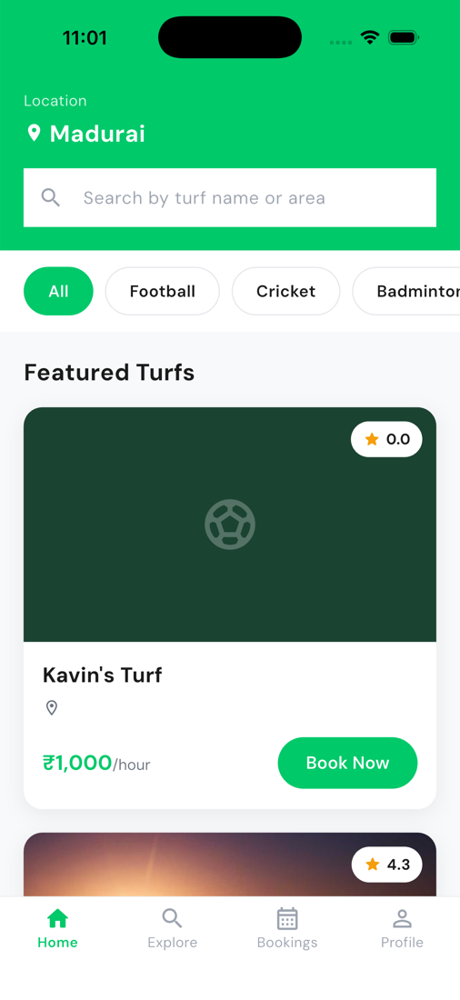
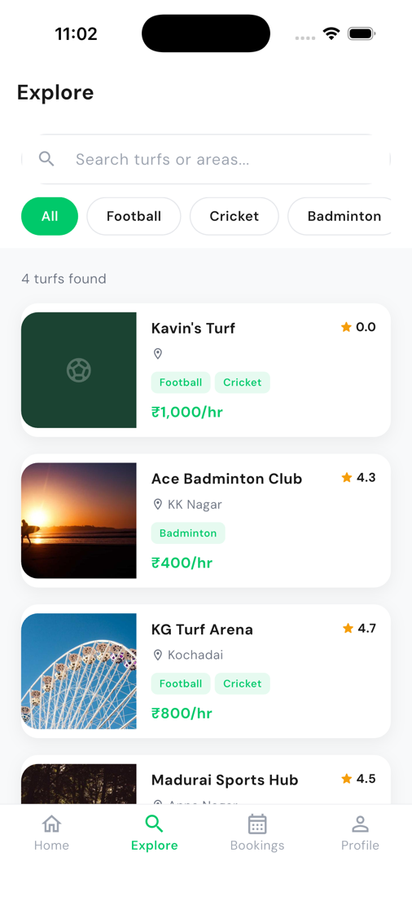
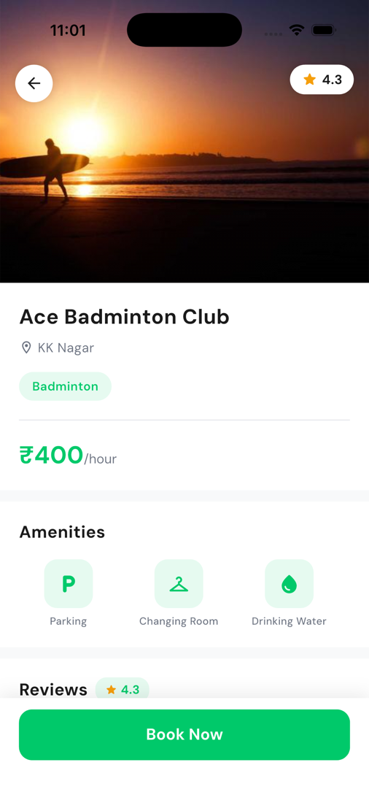
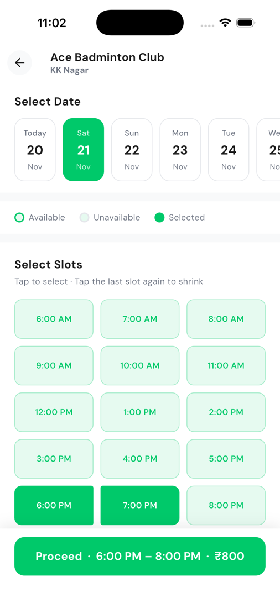
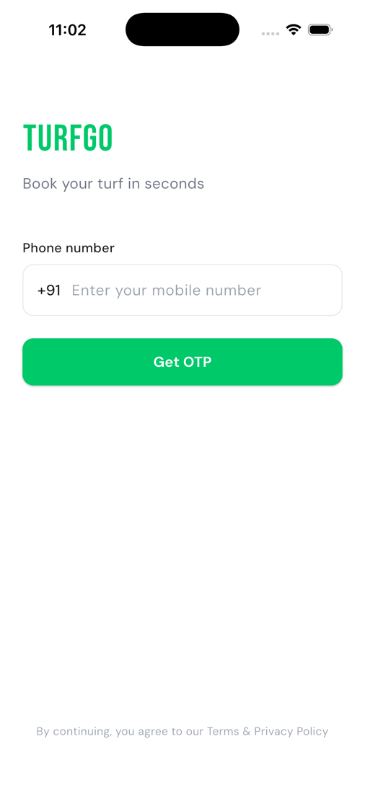
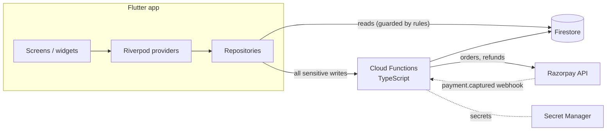
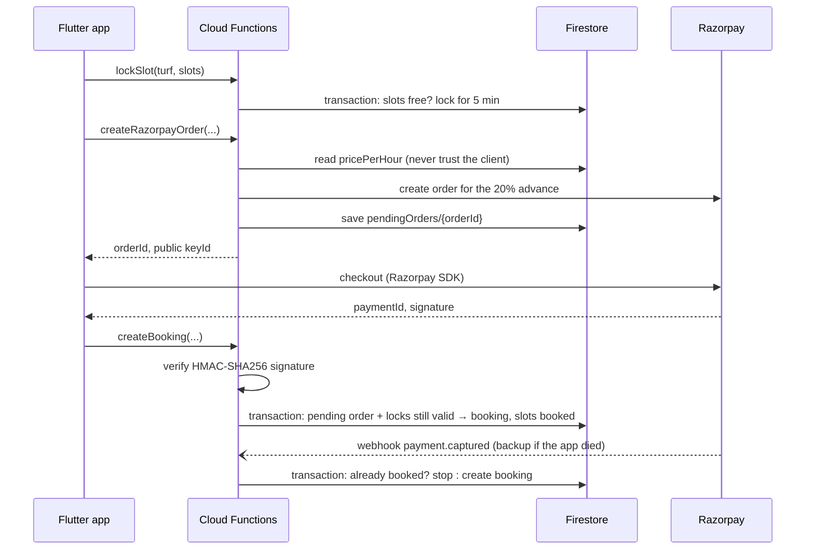

# TurfGo

**A sports-turf booking marketplace for India, built end to end with Flutter, Firebase and Razorpay.**

Players find a football or cricket turf, pick a time slot, and pay a 20% advance online. Turf owners manage their listings and bookings. An admin panel approves owners and tracks revenue.

> **Status: portfolio project.** I built TurfGo to launch in Madurai, Tamil Nadu. Before launching I did
> a market review, found the market was already served better than I could serve it, and stopped.
> The code is complete enough to read and run locally; it is not live and takes no real payments.
> [Why I stopped →](#why-i-stopped)

<p align="center">
  
  
  
  
  
</p>
<p align="center"><sub>Home · Explore · Turf detail · Slot selection (2 hours, ₹800) · OTP login, which appears only when you go to pay. Turf photos are placeholder demo data.</sub></p>

---

## At a glance

| | |
|---|---|
| **App** | Flutter (iOS + Android), 61 Dart files, ~16k lines, 3 roles: player, owner, admin |
| **Backend** | 12 Cloud Functions in TypeScript (~1.6k lines), Firestore, Auth, Storage |
| **Payments** | Razorpay orders, client SDK checkout, HMAC signature check, webhook fallback, refunds |
| **Security** | Server-side pricing, transactional slot locks, production-style Firestore rules, OTP rate limiting, App Check |
| **Architecture** | Widget → Riverpod provider → repository → Firestore / Cloud Function |

---

## What it does

**Players**
- Browse turfs without an account; search and filter by sport
- See live slot availability (real-time Firestore streams)
- Book 1–4 one-hour slots and pay a 20% advance; the rest is paid at the venue
- Log in with phone OTP only at the moment of payment
- Cancel a booking; more than 24 hours ahead triggers an automatic Razorpay refund

**Owners**
- Apply to list a turf (with photos); an admin approves or rejects the request
- Dashboard of bookings and earnings
- Edit turf details, court counts per sport and coaching hours
- Block and unblock slots (for maintenance or walk-ins)

**Admin**
- Approve or reject owner applications (approval creates the turf and grants the owner role)
- See every turf, booking and user; activate or deactivate turfs
- Revenue dashboard

---

## Architecture



**The rule that shapes everything:** the app can *read* most data directly, but anything involving money, availability or roles is written **only** by Cloud Functions. Firestore rules enforce that `bookings`, `slots`, `pendingOrders`, `transactions`, `payouts` and `otpAttempts` reject every client write, and that no user can ever change their own `role`.

### Payment flow



---

## Engineering decisions worth reading

These are the parts of the code I'd point a reviewer to.

**1. The server decides the price — three times.** `createRazorpayOrder` computes the amount from the turf's `pricePerHour` in Firestore, stores it in `pendingOrders`, and `createBooking` and the webhook recompute and compare it again. The client never sends an amount. Duplicate slot IDs are removed first, so `["slot1","slot1"]` can't fake a longer booking. (`functions/src/index.ts`)

**2. Two paths can create a booking, and only one ever does.** If the app crashes after payment, Razorpay's webhook creates the booking instead. Both paths re-read the pending order and look up existing bookings for that order *inside* their Firestore transaction, so they conflict with each other and Firestore retries the loser — which then sees the booking and stops. `createBooking` returns the existing booking, which makes it safe to retry.

**3. Slot locking with multiple courts.** A slot can have several courts, some reserved for coaching. `lockSlot` checks `courtCount − coachingReserved − bookedCount` and the 5-minute lock in one transaction, and `createBooking` re-checks that the *same* user still holds the lock before booking.

**4. Rules as a second line of defence.** Even if a Cloud Function had a bug, the client still couldn't write bookings, slots or roles. User creation forces `role == 'player'`; updates may only touch `name` and `cityId`. Owners can edit their turf's description but not `pricePerHour`, `ownerId`, `rating` or `isActive`. Everything not listed is denied by a catch-all rule. (`firestore.rules`)

**5. OTP abuse protection.** Phone OTPs cost money. `checkOtpRateLimit` allows 3 per phone number per UTC day, counted in a transaction so parallel requests can't slip through. Android auto-verification is disabled so the OTP screen can't be skipped.

**6. Secrets stay on the server.** Razorpay's key secret and webhook secret live in Secret Manager. The app only ever receives the public key ID, returned by the order function.

### Bugs I found in my own code (and fixed)

Reviewing the project before publishing it turned up real bugs — the kind that only show up when you read the code adversarially:

- **One payment could create two bookings.** The pending-order check ran *before* the transaction, so the app and the webhook could both pass it. Fixed by moving the check inside both transactions.
- **Every booking write would have failed.** `arrayUnion([id])` stores an array *inside* an array, which Firestore rejects. The correct call is `arrayUnion(id)`.
- **Cancelling a multi-hour booking crashed.** Firestore transactions require all reads before any writes; the loop read slot 2 after writing slot 1.
- **Cancelling wiped other people's locks.** On a multi-court slot, another player might be mid-payment; clearing the lock would make their payment fail.
- **Owner sign-up could never succeed.** The app and the Cloud Function disagreed on a field name (`userPhone` vs `phone`), and the app sent a server-timestamp object a callable can't serialise.

---

## Why I stopped

I planned to launch in Madurai on the assumption that turfs there still took bookings only by phone. Before launch I researched the market properly:

- **Playo already listed 62 bookable venues in Madurai** (45 for football). Playspots listed 9 more.
- **Hudle and OneOS charge venues 0% commission.** TurfGo's model took 13% of each booking.
- Phone and WhatsApp booking is free, covers every turf and pays owners in cash instantly — for many owners it's the real competitor.
- TurfGo had no signed turfs, and its advantages (a smaller upfront payment, no player fee) weren't enough to win either players or owners.

The honest conclusion: the problem was distribution and supply, not software, and competing on those against funded incumbents wasn't a good use of the next year. The full write-up, with sources and a scored comparison, is in [`docs/market-review.md`](docs/market-review.md).

**What I'd do differently:** talk to 10 turf owners *before* writing code, and price the product against what they already use instead of picking a commission rate first.

---

## Running it locally

Everything runs on the Firebase Local Emulator, so no live data is touched. You still need a Firebase project to generate the app's config file. Payment checkout needs Razorpay **test** keys.

**Prerequisites:** Flutter (stable), Node.js 20+, Firebase CLI (`npm install -g firebase-tools`), and a Firebase project to generate `lib/firebase_options.dart` (the emulator still needs a config file).

```bash
git clone https://github.com/kavincoder/turfgo.git
cd turfgo
flutter pub get
npm --prefix functions install

# Generates lib/firebase_options.dart (gitignored)
flutterfire configure
```

For payments, create `functions/.secret.local` (gitignored) with Razorpay **test** keys:

```
RAZORPAY_KEY_ID=rzp_test_...
RAZORPAY_KEY_SECRET=...
RAZORPAY_WEBHOOK_SECRET=...
```

Then, in two terminals:

```bash
npm --prefix functions run build && firebase emulators:start
```

```bash
flutter run --dart-define=USE_EMULATOR=true
```

The Emulator UI is at http://localhost:4000. To get demo data: sign in once in the app, then in the Emulator UI set your `users/{uid}.role` to `admin` and add a `turfs` document. As admin, the `seedSlots` Cloud Function creates bookable slots for a date.

> `lib/seed_main.dart` is an older seed script that writes to whichever Firebase project is configured — it does **not** use the emulator. Don't run it against a real project.

---

## Project structure

```
lib/
  core/            constants (colors, prices, roles, statuses), date utils, theme
  models/          plain Dart models with fromFirestore / toMap
  data/repositories/  every Firestore read and Cloud Function call lives here
  providers/       Riverpod providers — the only state layer for server data
  router/          GoRouter config with role-based redirects
  screens/         player, owner, admin and auth screens
functions/src/index.ts   all 12 Cloud Functions
firestore.rules          security rules (catch-all deny at the bottom)
storage.rules            image uploads: own folder, images only, < 5 MB
scripts/                 admin scripts (seed slots, create owner, migrate slots)
website/                 static landing page with an owner waitlist
docs/                    market review and an earlier progress report
```

---

## Tech stack

| Layer | Technology |
|---|---|
| App | Flutter, Dart 3.8, Riverpod 2, GoRouter 14, flutter_screenutil |
| Backend | Firebase: Firestore, Auth (phone OTP + email for owners), Storage, Crashlytics, App Check |
| Server logic | Cloud Functions v2, TypeScript, Node 20 |
| Payments | Razorpay (orders API, Flutter SDK, webhooks, refunds) |

---

## Known limitations

Being upfront about what isn't done:

- **Tests are minimal** — the Cloud Functions and rules are not covered by automated tests yet.
- **Not deployed** — the latest Cloud Function and rules changes were never deployed; the project is not running anywhere.
- **No push notifications** — owners aren't alerted to new bookings.
- **No owner payouts** — bookings are marked `payoutStatus: "pending"` and nothing processes them.
- **No review screen** — the `submitReview` function exists, but no screen calls it.
- **Admins can't change a user's role** from the users screen (rules block it; approving an owner request is the supported path).
- Node 20 is past its deprecation date for Cloud Functions; it would need upgrading to Node 22 before any deploy.
